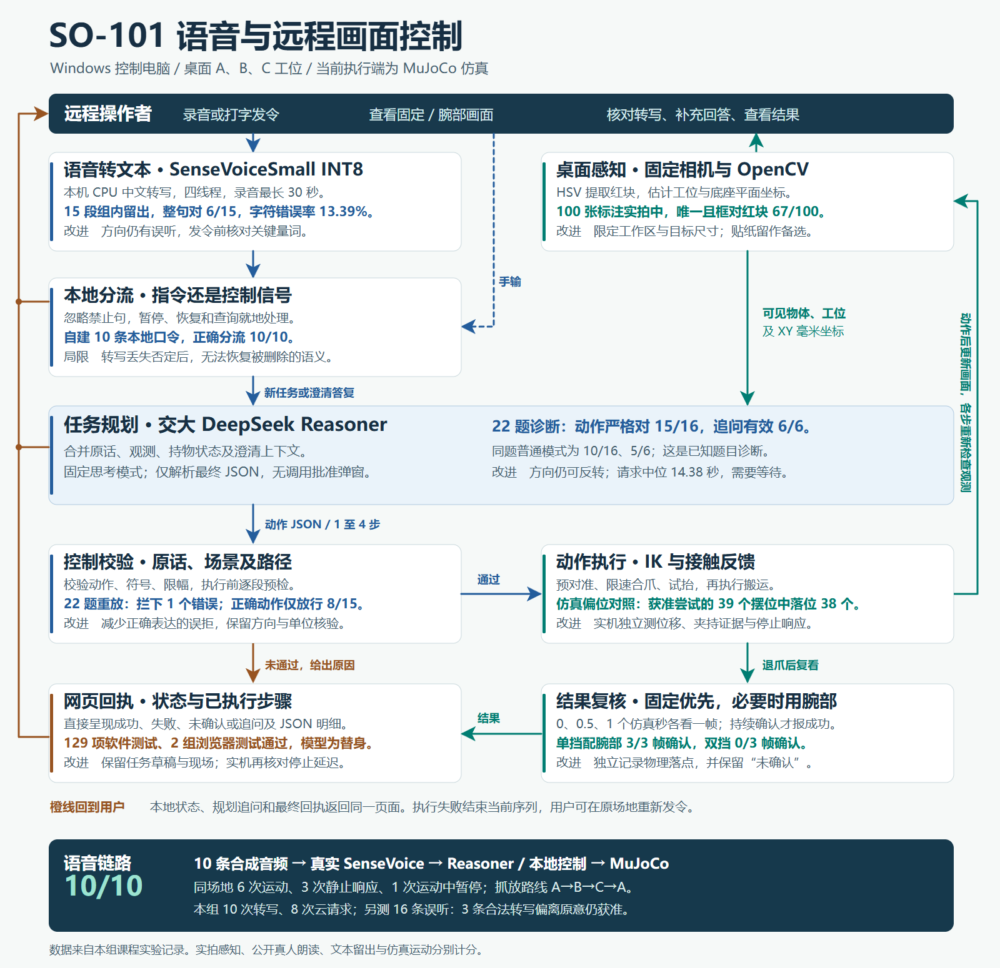

# SO-101 语音与远程视觉机械臂控制

## 1. 项目简介

本项目面向固定底座 SO-101 从臂的桌面操控任务，将语音识别、视觉感知、大模型规划和运动执行连接为一条可验证的工作流程。操作者通过浏览器查看固定相机或腕部相机画面，以中文描述搬运目标，也可以直接指定平移距离或腕部转角。系统将文字与当前观测转换为控制 JSON，经参数与路径校验后执行，并返回实际结果。

当前交付版本运行于 **MuJoCo 仿真**，支持 A/B/C 三个工位之间的搬运、抓取后持物、定量平移、腕部转动及最多四步的组合任务。基准目标为一个 24 mm 红色木块；真机控制适配与现场验收尚未完成。项目按课程原型范围设计，不训练机器人策略模型。

## 2. 技术组成

| 环节 | 采用的技术 | 输入、输出与运行位置 |
| --- | --- | --- |
| 语音转写 | SenseVoiceSmall INT8；sherpa-onnx 1.12.40、ONNX Runtime 1.32.0 | 在控制电脑 CPU 上运行，使用 4 线程；PyAV 将录音解码为 16 kHz 单声道音频，输出中文文本。单段最长 30 秒，支持转写后校对。 |
| 视觉感知 | OpenCV 4.11，HSV 颜色分割与连通域分析 | 在控制电脑处理相机图像，输出候选物体、工位和台面 XY 坐标。固定相机负责全局观测，腕部视角用于部分遮挡条件下的复核。 |
| 任务规划 | 上海交大“致远一号”的 deepseek-chat | 使用云端 API，输入文字、物体位置和必要的对话状态；输出有限动作 JSON 或澄清问题。温度为 0，每次最多输出 160 tokens。 |
| 本地控制 | Python 规则、参数校验、IK 与路径预检 | 本地处理查询、禁止句、暂停和恢复；校验模型动作的工位、轴向、量值及路径，再分段执行。 |
| 仿真执行与验证 | MuJoCo 4.0.0；独立运动学实现 | 通过夹爪接触、试抬和释放后的连续观测检查执行结果。独立物理位置用于实验判分。 |
| 界面与反馈 | FastAPI、Uvicorn、浏览器；可选 Edge-TTS | 网页显示画面、转写、规划与回执。Edge-TTS 为在线语音合成，需另行批准；当前完整链路测试终点为文字回执。 |

各环节的数据格式、状态转换、控制边界及来源见[系统设计](docs/workflow.md)。Whisper Small 保留为历史对照入口，当前默认使用 SenseVoiceSmall。

**目标颜色的范围：当前实现限定红色，尚无可直接切换颜色的配置项。** 更换单一目标颜色，需要同步修改固定与腕部视觉使用的颜色阈值、物体描述和验证用例；若同时放置多种颜色并按口令选择，还需增加稳定的物体编号、颜色属性与执行目标绑定。目前协议固定使用 `red_1`，仅更改提示词无法完成多颜色选择。具体改造位置见[系统设计中的颜色扩展说明](docs/workflow.md)。

## 3. 环境配置与运行

### 3.1 需要几个环境

**当前软件只需要一个 Python 虚拟环境：项目根目录的 `.venv`，由 uv 统一管理。** 语音、视觉、规划客户端、网页服务和仿真共用这个环境。`voice`、`data` 是同一环境内的可选依赖组。当前 CPU 方案无需单独配置 CUDA、Conda、ROS 或前端 Node.js 环境，也无需在本地部署 DeepSeek。

已验证平台为 Windows 11、Python 3.12。请先准备 Git 与 uv；uv 的 Windows 安装方法见[官方安装文档](https://docs.astral.sh/uv/getting-started/installation/)。浏览器使用 Edge 或 Chrome。以下命令均在 PowerShell 中执行。

### 3.2 安装项目并验证仿真

~~~powershell
git clone https://github.com/duanwwww/so101-voice-arm-lab.git
cd so101-voice-arm-lab
uv python install 3.12
uv sync --frozen --extra voice --extra data

# 统一使用公开仓库自带的独立 IK；此变量仅作用于当前终端
$env:VOICE_ARM_KINEMATICS = 'standalone'

# 离线文字指令，无需模型密钥或语音权重
uv run --frozen --extra voice --extra data python -m arm_lab run --layout A "把 A 区的木块搬到 B 区"
~~~

依赖版本由 `uv.lock` 锁定。`uv run` 会使用项目环境，无需手动激活。成功时终端返回包含 `status: success` 的执行回执。公开仓库包含几何模型与独立 IK；历史课程 IK 的测量结果在实验文档中单独注明。

### 3.3 配置语音与规划

本地规则仿真可先直接运行。启用语音时，在批准下载权重后执行以下命令；权重缓存在 `outputs/models/`，音频不发送至校方模型。

~~~powershell
uv run --frozen --extra voice --extra data python -m arm_lab.sensevoice --approve-download
~~~

使用 DeepSeek 前，在本机创建配置文件，并在编辑器中填写 `SJTU_DEEPSEEK_API_KEY`。也可通过 `SJTU_DEEPSEEK_ENV_FILE` 指向已有课程配置，二者选一种即可。

~~~powershell
# 已有配置时保留原文件
if (-not (Test-Path .env)) { Copy-Item .env.example .env }
~~~

校方接口固定为 `https://models.sjtu.edu.cn/api/v1/chat/completions`。密钥保存在本机，不提交至 GitHub。转写、云端规划、回执解读和在线播报分别授权；此前实验的批准次数不作为新运行的授权。

### 3.4 启动与操作

~~~powershell
uv run --frozen --extra voice --extra data --env-file .env python -m arm_lab serve
~~~

打开 [http://localhost:8768](http://localhost:8768)。端口已占用时，可在命令末尾加 `--port 8773`；前台服务按 Ctrl+C 退出。

1. 首次选择仿真场景并初始化。后续发令、暂停或补充回答均保留当前场地。
2. 选择“本地规则 · 离线”测试文字任务，或选择“交大 DeepSeek · 自然语言”并批准本次规划请求。
3. 上传录音或使用麦克风，批准本地转写；核对文本后提交动作，查看步骤回执和最终画面。

例如，“把木块放到右边的工位”描述搬运目标；“向左移动十二毫米”指定相对平移；“向前移动五”缺少单位，会要求补充。“不要向前移动一厘米”忽略该句；“暂停当前任务”终止剩余步骤并保留现场。执行中可继续录音，新运动请求不会自动插入当前动作。

首次复现建议使用本机浏览器。局域网部署、远程授权、麦克风 HTTPS 条件和断线后的处理见[系统设计](docs/workflow.md)；真机接线与现场配置见[真机接入](docs/hardware.md)。

## 4. 实验结果与复现

### 4.1 已完成的实验

不同实验使用不同样本和判据，下表分别报告，不能将各项比例相乘作为系统总体成功率。

| 实验与目标 | 测试数据及验证方法 | 已记录结果 |
| --- | --- | --- |
| 语音识别：保留方向、数值、单位与否定 | AISHELL-1 的 24 段真人录音；字符错误率与关键词事件核对。另列 4 段合成控制口令。 | 同批真人录音 CER：Whisper beam=1 为 20.51%，beam=3 为 17.70%，SenseVoice 为 10.67%。SenseVoice 转写总耗时 3.841 s，模型加载另计；方向仍有误听。 |
| 文本规划：生成正确控制 JSON | 自建 100 条带参考答案的输入，40 条开发、60 条留出；留出含 42 个动作、12 个规划追问和 6 个本地口令。 | 原始动作 JSON 严格匹配由 15/42 提升至 27/42。终选版的 11 个错误运动提议在该批控制层重放中全部被拦截，仍存在正确表达被误拒绝的情况。 |
| 视觉：定位红块并识别误报 | 100 张含红块的公开实拍标注图；另测 264 张外部仿真图，其中 77 张不含红块。 | 实拍中 67/100 得到唯一正确候选；77 张无红块图中有 57 张误报。颜色分割不具备通用物体识别能力。 |
| 完整链路：语音到规划再到执行 | 4 段合成录音经真实 SenseVoice、DeepSeek／本地分流及 MuJoCo；独立检查位移、接触和落位，场地不重置。 | 4/4 达到预期，包含 2 次运动、2 次原位响应；12 mm 平移的仿真三维误差约 0.226 mm。 |
| 误听纠偏：“右干”能否恢复为右侧工位 | 在 A、C 初态对同一错误转写与正确原文各测一次；比较原始 JSON 与实际抓放。 | 4/4 JSON 正确且搬运完成。加上主链路，同一误听案例共成功 3 次；复用一份转写，不代表 3 个独立语音样本。本轮共 6 次云端调用。 |
| 共享版复现与回归 | 使用公开版独立 IK 重放上述 4 份真实回复，并运行自动化回归。 | 重放 4/4；回归 106 项通过。没有新增模型调用。 |

语音语料划分、数据下载、原始回复、各项分母、运动与遮挡实验及失败分析统一见[实验与复现](docs/experiments.md)。全部结果来自仿真、本地录音评测或外部数据回放，实机测试次数为 0。

### 4.2 无模型调用的复现

以下命令在项目根目录执行。第一项复用已保存的真实模型回复检查执行后端；它不重新评估 ASR 或云端规划。输出写入 `outputs/`，再次运行时为保留记录应更换输出文件名。

~~~powershell
$env:VOICE_ARM_KINEMATICS = 'standalone'

# 已保存的 4 份真实模型回复 → 独立 IK → 仿真物理验证
uv run --frozen --extra voice --extra data python -m scripts.replay_sensevoice_pairs --out outputs/reproduce_pairs.json

# 运行仿真场景评测，包含抓放、相对移动和遮挡处理
uv run --frozen --extra voice --extra data python -m arm_lab evaluate --out outputs/reproduce_scenarios

# 软件回归；模型接口在测试中使用替身
uv run --frozen --extra voice --extra data python -m unittest discover -s tests -v
~~~

### 4.3 重新运行真实语音与云端规划

准备好权重、密钥，并取得新一轮模型调用批准后，运行以下命令。第二条命令中的额度包含第一条报告的已用次数，累计不超过 8 次；禁止句与缺单位句由本地处理，不发送云端。

~~~powershell
uv run --frozen --extra voice --extra data --env-file .env python -m scripts.evaluate_sensevoice_flow --approve-local-asr --approved-campus-attempts 8 --out outputs/reproduce_flow_live.json
uv run --frozen --extra voice --extra data --env-file .env python -m scripts.evaluate_sensevoice_pairs --source outputs/reproduce_flow_live.json --approved-campus-attempts 8 --out outputs/reproduce_pairs_live.json
~~~

100 条规划输入的离线重新评分、24 段公开录音评测和 OpenCV 数据评测命令集中在[实验与复现](docs/experiments.md)，避免在首页重复展开。仿真视频见[3 分 14 秒演示](results/safety/simulation_demo.mp4)；该视频展示离线文字控制流程，与最新真实语音联调分别记录。

## 5. 性能瓶颈与本阶段范围

| 当前瓶颈 | 现有证据与影响 | 后续提升方向 |
| --- | --- | --- |
| 视觉目标身份不可靠 | 红色背景、苹果或碗可能成为候选；误检会传递到规划环节。 | 优先限定工作区、目标尺寸和光照；评估轻量目标检测。ArUco 贴纸保留为备选。 |
| 控制 JSON 的语义精度不足 | 留出动作严格正确仅 27/42，仍有方向符号错误；规则也会误拒绝正确措辞。 | 针对方向、单位、合法目标混淆做成对测试；完善语义校验，使用开发集迭代并保留独立留出集。 |
| 关键语音词仍可能误听 | 整体 CER 降低，但方向词未全部正确；“右干”纠偏只覆盖一个案例。 | 补充现场真人指令、背景噪声与否定最小对；关键信息不明时要求确认。 |
| 仿真与实机反馈不同 | 接触、摩擦、关节零位和夹持中心尚无本机实物数据支持。 | 先验证停止、空爪小位移、夹持后的停收紧，再做低位抓放；记录实际位移与失败原因。 |

**本阶段保留的简化：** 单一红色目标、已标定的 A/B/C 工位、有限动作集和逐段执行；抓取失败或落位无法确认后停止当前序列，等待操作者核对，不自动无限重试。连续流式语音、任意物体／多颜色选择、任意空间抓取、视觉语言模型和在线学习不纳入本阶段完成范围。

**进入真机前必须完成：** 型号与接口确认、设备适配、相机与工位标定、夹爪反馈和停止逻辑验证、独立位移测量及受控场地试验。当前没有完成真机闭环，也不能用仿真误差承诺实机精度。具体安排见[真机接入](docs/hardware.md)。

## 核心文档与工程目录

| 阅读入口 | 内容 |
| --- | --- |
| 本 README | 项目概览、技术选型、单环境配置、运行与主要结果 |
| [系统设计](docs/workflow.md) | 模块协议、交互状态、控制机制、颜色扩展、相关方案与来源 |
| [实验与复现](docs/experiments.md) | 测试任务、数据集、结果、失败归因及分项复现命令 |
| [真机接入](docs/hardware.md) | 设备与配置改造、场地机位、标定、预约实验与验收 |

`arm_lab/` 为运行代码，`configs/` 为提示词与测试配置，`scripts/` 为评测脚本，`tests/` 为软件测试，`results/` 为已记录证据，`outputs/` 为本机缓存及复跑输出。原分阶段文档集中至 `docs/archive/`，供溯源使用。开源模型与资源说明保留在 [NOTICE](vendor/so101_course/NOTICE.md)。

[公开 GitHub 仓库](https://github.com/duanwwww/so101-voice-arm-lab) · [下载 ZIP](https://github.com/duanwwww/so101-voice-arm-lab/archive/refs/heads/main.zip)
