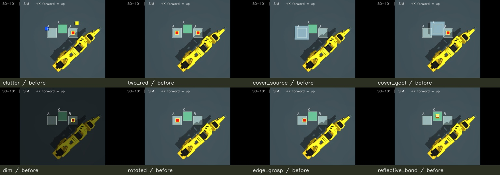

> 历史归档：本页保留阶段性设计与实验记录，部分默认设置已更新。当前说明以[项目首页](../../README.md)、[系统设计](../workflow.md)、[实验与复现](../experiments.md)及[真机接入](../hardware.md)为准。

# 多场景仿真与真实数据验证

本页为 11 月 25 日固定相机版本的基线。新版在同一遮挡条件下增加腕部复核，并在可能漏抓的边缘摆位提前停止。[11 月 26 日对照报告](control_iteration.md)

2026 年 11 月 25 日，在 Windows 上通过 uv 运行了 27 个 MuJoCo 用例、100 张外部实拍图像及 128 段外部实机轨迹。仿真回答“红块抓起后放到了哪里，控制器在证据不足时如何回复”。实拍图检验红块定位，实机轨迹检验夹爪开合判据。三项实验均在本机完成，模型调用 0 次，未连接机械臂。[仿真逐步记录](../../results/scenarios/report.json) · [真实数据逐样本记录](../../results/scenarios/real_data.json)

## 八个可以在控制台复现的场景

打开控制台，选择“本地规则 · 离线”，在“仿真场景”中选一项，依次点击“重置仿真”“填入场景任务”“执行指令”。输入框中的文字可自行修改。每次重置会恢复该场景的起始摆位。[本机控制台](http://127.0.0.1:8768/)

| 场景与编号 | 布置及任务 | 实际观察 |
| --- | --- | --- |
| 异色干扰与接力搬运 `clutter` | 红块在 B，工位外加蓝、黄两枚道具。先放到 C，再放到 A。 | 两次抬升均有双侧夹持并离桌超过 20 mm。C、A 每次落位都被连续确认三次。 |
| 两个红色候选 `two_red` | A 的木块与 B 的红色道具同时可见，要求搬红块。 | 图像给出 A、B 两个候选。系统请求澄清，关节保持原位。 |
| 取料位被遮挡 `cover_source` | A 有木块，挡片遮住固定相机看向 A 的视线，要求抓取。 | 起始画面的检测数为 0，系统告知未找到木块，关节保持原位。 |
| 放料位被遮挡 `cover_goal` | B 的木块可见，目标 C 的相机视线被挡住，要求 B→C。 | 仿真中木块已完整落入 C，三次采样都只接触桌面。相机三次都看不见木块，控制端回报“释放后未能确认木块稳定在 C 区”。 |
| 低曝光 `dim` | 将相机 RGB 通道增益降为 45%，要求 B→A。 | 仍检测到一个红块，机械臂完成抓放，相机连续确认 A。 |
| 轻微偏摆 `rotated` | 从 A 的中心横向偏 4 mm，再绕竖轴转 8°，要求 A→B。 | 顺利夹起并放至 B。这个单一姿态只给出一个经过验证的摆位。 |
| 工位边缘与中途失败 `edge_grasp` | A 内横向偏 19 mm。先向左移 1 cm，再搬到 C，最后转腕 3°。 | 首步位移完成，第二步漏抓，抬升时木块仍接触桌面。回执为已完成 1/3 步，末步转腕没有执行。 |
| 反光条分割红面 `reflective_band` | 在 C 的同一块木块上画一条白带，近似表面反光造成的红色区域断裂，要求 C→A。 | 图像将一个实体分成两个 C 区候选。控制器追问，关节保持原位。 |

每个场景只有一块能受力移动的木块。挡片和干扰道具只改变相机画面，白带只改变表面颜色。控制器使用 RGB、指尖接触和关节反馈。测试器另行读取自由木块的姿态、尺寸和接触，检查各次抬升及退爪后三次落位，因而能复核相机失去视野后的实际结果。[仿真和检测的验收代码](../../arm_lab/evaluate.py) · [接力搬运与目标遮挡的结束画面](../../results/scenarios/relay_and_blind_goal_after.jpg)

新增 8 项中，3 项完成任务、3 项追问且未运动、2 项回报未确认。加上此前 19 项，27/27 项都符合各自预期。20/20 项单元与接口测试通过。独立 Edge 浏览器还验证了在网页选场景、填入示例、实际执行并显示遮挡回执的流程。[场景与数据指标测试](../../tests/test_scenarios.py) · [浏览器脚本](../../tests/browser_smoke.py)

## 外部实拍图像能否唯一定位红块

VigiClaw 的 real 子集有 100 张 640×480 图像，发布方提供四种颜色共 399 个物框，其中每张恰有一个红块。使用全部 100 张，固定数据版本 e2e9acfbfdf827776c06673ee4103c970ac0d29b。数据站把这些图列在 train，未另设官方测试集。发布页未交代拍摄设备、框的标注方式或再发布许可，工程只提供复现程序与逐图派生指标。[发布者数据卡](https://huggingface.co/datasets/pengxianglu/vigiclaw-yolo-dataset) · [固定版本图像及标注清单](https://huggingface.co/datasets/pengxianglu/vigiclaw-yolo-dataset/tree/e2e9acfbfdf827776c06673ee4103c970ac0d29b/real/images)

用项目已有的 OpenCV HSV 红色分割器处理整张图。保留原有阈值与最小连通面积，未用这批图训练或调参。对每张图选择与红块参考框交并比（IoU）最高的检测框。IoU ≥ 0.50 即记一次命中，同图其余候选一律记误检。工位投影需要本组相机标定，评测只比较二维框。

| 判据 | 测量结果 | 对操作者的意义 |
| --- | ---: | --- |
| 与参考框匹配 | 95/100 张 | 95 张图的候选中含有正确红块。 |
| 同图恰好一个候选且正确 | **67/100 张** | 这 67 张可直接给出唯一目标。32 张有多个候选，另 1 张唯一的候选也没有匹配。 |
| 全部候选 | 95 真阳性、187 假阳性、5 假阴性 | 精确率 33.69%，召回率 95.00%，F1 为 0.4974。 |
| 匹配框的中心误差 | 中位数 1.55 像素 | 仅计算 95 个命中框。像素误差转换成台面毫米需要相机标定。 |

逐图抽查可以看到，橙色臂身、附件与部分阴影也会进入红色阈值。样本 `image_20260515_224838_915.jpg` 命中红块的同时产生 14 个误框。另一类失败是红块受反光影响，完整色块变成几块碎片。`image_20260515_223302_378.jpg` 的两个候选中，最佳 IoU 仅为 0.265。仿真的“反光条分割红面”由这类失败启发。实际使用时，发现多个红色区域就自动抓第一个，会在这种画面里选错。[本组的逐图结果](../../results/scenarios/real_data.json) · [当前视觉实现](../../arm_lab/vision.py)

## 真实 SO-101 轨迹能否从夹爪开合确认一次动作

Aswinkumar 发布的 LeRobot-SO101-Pick-Place 包含真实 SO-101 的海绵抓放演示、相机视频、关节动作与观测，数据卡标注 MIT。取固定版本 6f1ceec7b23629d9fcdaf819a7d312f019172977 中“单海绵、无干扰物”的两个完整目录，共 128 回合、74,887 个 30 Hz 采样时刻。按回合和帧号顺序回放指令与实测的 gripper.pos。此次分析读取 Parquet 数值通道，未解码视频。[数据卡及采集说明](https://huggingface.co/datasets/aswinkumar99/LeRobot-SO101-Pick-Place) · [固定版本的任务目录](https://huggingface.co/datasets/aswinkumar99/LeRobot-SO101-Pick-Place/tree/6f1ceec7b23629d9fcdaf819a7d312f019172977/task1-single-sponge-no-distractors)

先在固定摆位的指令通道取第 5 至 95 百分位，再取这个区间的 25% 和 75% 为低、高阈值，分别约 10.22 和 26.49，沿用数据原生单位。锁定阈值后检查随机摆位。指令和实测通道各自须出现高→低→高三个阶段，每段至少持续 3 帧。若两通道进入低位和再次进入高位的时刻都相差不超过 15 帧（0.5 秒），记为一次时序吻合。

| 数据划分 | 回合 / 采样帧 | 指令出现完整序列 | 实测出现完整序列 | 两个转换时刻均吻合 |
| --- | ---: | ---: | ---: | ---: |
| 固定摆位，用于定阈值 | 64 / 30,160 | 2/64 | 1/64 | 1/64 |
| 随机摆位，沿用同一阈值 | 64 / 44,727 | 15/64 | 12/64 | **10/64** |

随机摆位中，所有 64 段实测轨迹都到过低位，只有 45 段到过高位，12 段完整呈现规定顺序。由此可见，一套固定开度与起止顺序会漏掉许多实际演示。10/64 衡量该规则对轨迹的覆盖，数据表没有给本项目的红块接触或 A/B/C 落位标签，无法据此计算抓取成功率。真机回执需要把夹爪读数与退爪后的目标观察结合起来。[逐回合开合时刻与误差](../../results/scenarios/real_data.json) · [判定实现](../../arm_lab/real_data.py)

## 课程展示与后续复核

有限的演示时间可选两个场景。先演示“异色干扰与接力搬运”，展示第二次抓取确实使用 C 的新观测。再演示“放料位被遮挡”，同时给出受遮挡的实际画面、控制端的未确认回执与仿真另存的落位证据。若后续预约到真机，优先在同一机位记录无遮挡、目标遮挡和边缘偏位各三次，保存操作者指令、前后图像、夹爪读数与人工核对的实际落点。这样能直接比较用户收到的回执和木块的真实去向。

如果后续任务改为分析“成功与失败怎样出现在画面里”，JHU CoSTAR 公开了近 12,000 次真实机械臂方块堆叠尝试，含光照变化、干扰物、成功和失败例。该数据使用不同机械臂，列为备选，本次统计只包含上面两套。[JHU CoSTAR 原始项目](https://sites.google.com/site/costardataset)

Windows 上的安装、首次下载与离线复跑命令见工程首页。逐图记录含文件 SHA-256，逐回合记录含轨迹文件 SHA-256。100 张原图、1 份标注清单和 2 份轨迹文件均已与发布仓库固定版本的文件哈希核对。本机断网模式复跑的输出 JSON 与首次报告逐字节一致。[复现步骤](../../README.md#复现实验)
