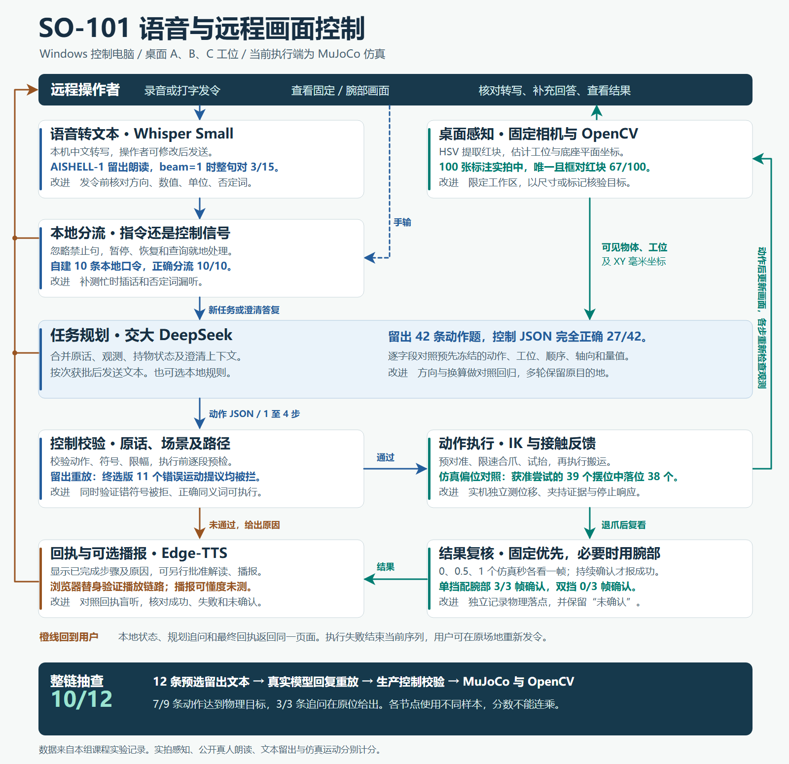

# SO-101 语音与远程画面控制工作流

操作者看着远程画面说“把左边的红木块放到 B”。Whisper 在控制电脑上生成可编辑的文字，OpenCV 从固定相机图像中提取目标和工位。经批准，上海交大 DeepSeek 接收文字和场景摘要，提出动作或追问。控制器将获准的动作交给 MuJoCo 执行，最后通过画面和反馈确认结果。当前系统支持一个 24 mm 红块、三个工位及固定底座。实体驱动需要另行接入。[仿真使用说明](../README.md) · [真机接口清单](real_commissioning.md)

[打开可放大的矢量原图](workflow.svg) · [3 分 14 秒仿真演示](../results/safety/simulation_demo.mp4) · [接真机要改的配置、机位和实验顺序](hardware_handoff.md)

## 逐节点的输入、证据和改进

| 节点与数据流 | 任务指标 | 怎么验证 | 优先改进 |
| --- | --- | --- | --- |
| **远程输入与监控**。网页录音或手输，接收状态和所选相机的 JPEG。新任务携带当前场景版本。 | 连接可靠性使用掉线处置时间。测试期限 1.2 s，搬运中关页后 1.27 s 收到仿真锁止回执。日常默认期限 3 s。 | 本机 Edge 真的关页，另一回合仅阻断相机。4 次图片失败期间仍收到 2 次状态回复，成功续期 0 次。远程网络时延与真机制动时间均待测。[失联实验](../results/safety/link_loss.json) | 在课程网络记录采集到显示的图像延迟及断流时间。现场独立验证持物暂停后失联，并配本地停止。 |
| **语音转文本**。控制电脑上的 Whisper Small，中文、CPU INT8，网页运行 beam=1。操作者编辑文字后确认发送。 | AISHELL-1 的 15 段留出朗读：beam=1 字符错误率 23.85%，整句对 3/15。相同录音改用 beam=3，字符错误率 20.92%，整句仍是 3/15。 | 24 段、5 位说话人，逐段对官方转写，两种解码设置各测一遍。全部 24 段的方向出现 9 次，两版都对 7 次。beam=1 的数值、单位和否定标志分别对 12/12、10/12、9/10。[原音清单与逐词判分](asr_benchmark.md) | 小规模补录真实机位、麦克风和噪声下的方向、量纲、否定口令。保留人工校字，配对验证 beam=3 是否值得切换。 |
| **本地分流与插话**。禁止、暂停、恢复和查询按整句判别，缺单位等情况可本地追问。忙时新动作保留为网页草稿。 | 100 条输入中有 10 条应走本地，10/10 得到预期处理结果，云端调用 0 次。 | 用事先写好的本地响应类别逐项比对。另用接口测试验证暂停会取消剩余动作，旧任务返回后恢复控制仍需显式提交新任务。[分流计数](../results/safety/planner100/summary.json) · [忙时回归](../tests/test_live_interaction.py) | 同一句话分别加入停顿、转写漏字和并列命令，测漏停与意外启动。实时中止继续保留网页按钮。 |
| **视觉感知**。固定相机 RGB 经 OpenCV 的 HSV 分割和连通域提取候选，再按标定投影到底座 XY。可见性与工位形成规划摘要。 | 100 张有红块的实拍中，95/100 检到目标，67/100 唯一且检测正确。77 张无红块的外部仿真图中，57/77 出现单个假候选。 | 与发布者标注按 IoU ≥ 0.5 匹配，统计漏检、多框和错框。本组另做 100 个仿真摆位。72 个含工位内唯一目标，固定相机及腕部正确定位数为 42 和 56。固定成功样本的 XY 误差中位 0.83 mm。[视觉验证与混淆案例](vision100.md) | 限定台面工作区，用尺寸或身份标记验证红块。在不同光照下计数红色杂物的误报，腕部作为独立复核视角。 |
| **文本与场景转行动**。交大“致远一号” deepseek-chat 收到原话、可见目标、工位、可选坐标和适用的多轮状态，返回至多 4 步或追问。 | 终选版协议合格 49/54。42 条动作题中，27/42 与金标字段、数值和顺序完全一致（64.3%），原版为 15/42。12 条应追问题中返回追问 9 条，逐句复核可用 7 条。 | 先冻结 100 条自建文本和金标，按 40 条开发、60 条留出分组。对留出的 54 条规划题获取两版真实回复，另外 6 条走本地。逐字段比较并单列等价抓放。[逐条模型答卷与金标](../results/safety/planner100/by_case.json) · [追问复核](planner100_asks.md) | 为方向正负号、单位和多轮改工位建立新表述的回归。典型错误是把向右 2.5 cm 写作 +25 mm，本项目底座 +Y 朝左。 |
| **控制校验与路径预检**。校验动作 JSON、目标工位、原话和量值。每步执行前重新观测，检查工作区、IK、臂段和已登记障碍。 | 54 条留出回复中，终选版提出 11 个含义错误的物理动作，生产校验拦住 11 个，误放 0 个。校验后整体符合题意的是 30/54，包括正确动作与追问。 | 将保存的原始模型回复送回同一个校验入口，分别计错动作、拦截和误放。另在仿真路径中加入支架和持物挡针，比较端点及整段检查。[语义校验重放](../results/safety/planner100/guard_replay.json) · [几何路径实验](../results/safety/route_ablation.json) | 使“X 正方向”“向下俯”能正确通过，同时拒绝相反方向。现场重新测量支架和线缆占据的空间。 |
| **执行抓放与定量移动**。台面偏位在允许范围内时微调抓点。双侧接触后锁存开度、限幅握持、试抬 6 mm，再搬运。反馈无效或夹持中掉落则停止。 | 在 63 个偏位摆位中允许下爪 39 次，38/39 落位（全部摆位为 38/63）。另测短平移 18 次，三维误差中位 0.245 mm，转腕 6 次误差约 0.006°，均为仿真值。 | 63 个相同摆位分别跑固定抓点和视觉对准。用独立仿真物理状态验证木块落位，用末端姿态和腕关节读数核对位移与角度。[逐摆位及定量运动记录](../results/safety/control_benchmark.json) | 实机用独立尺或标记测位移和角度。确定实际可读的夹持反馈、报警和停止条件，单独验收空抓与卡住。 |
| **落位复核**。释放退开后，固定相机在 0、0.5、1 个仿真秒各看一帧。固定相机无目标时可用腕部回看，若有歧义则保留“未确认”。 | 三种场景各做一次固定相机与一次启用腕部的对照。C 工位仅固定视角被挡时，固定独立确认 0/3 帧，启用腕部确认 3/3 帧。双视角均挡时确认 0/3，物理真值仍已落位。 | 独立读取木块位置和桌面接触，对比视觉回执。这里的 3 帧来自同一次释放，不能当成 3 次独立搬运。[相机对照实验](../results/safety/control_benchmark.json) | 现场计数“实际未落位却报成功”和“已落位但看不清”。固定腕部相机、校验视野和工具外参，记录夹爪退开后的帧。 |
| **回执、解读与播报**。控制端显示已执行步骤、状态和原因。用户可另行批准用 DeepSeek 解读，或用微软在线 Edge-TTS 朗读回执。 | 已验证接口、回执编号、批准及播放路径。解读忠实度、真实听者对播报的理解率均未量化。 | 浏览器测试用替身模型走通录音、规划、运动、反馈文本和音频播放，运动经 MuJoCo 步进。回执是执行器产生的原始记录。[浏览器记录](../results/safety/browser/browser.json) · [授权和反馈测试](../tests/test_deepseek.py) | 从成功、失败、未确认各取回执，检查解读是否保留状态，让听者据播报复述结果并核对。 |

## 一条搬运任务怎样结束

假设画面只看到 A 的一个红块，用户要求从 A 搬到 B。符合协议的规划是下列单个 JSON。

~~~json
{"steps":[{"action":"transfer","object":"red_1","from":"A","to":"B"}]}
~~~

控制器会复查 A 的位置和路线，独立完成对准、闭合、试抬与放置。若用户坚持从 A 抓，固定画面却只在 C 找到红块，应回到用户澄清。若试抬时夹持反馈无效，序列停止；若释放后三帧不能持续确认，返回“未确认”。操作者可保留桌面摆位进行后续交互。明确暂停会取消尚未执行的步骤；普通“恢复控制”不会自动重放旧动作。发生锁止的仿真需人工重置。[执行代码](../arm_lab/flow.py) · [仿真抓取控制](../arm_lab/simulator.py) · [交互状态说明](deployment.md)

**端到端结果的起点是文字。** 看留出回复前先选定 9 条动作、3 条追问，将真实校方输出分别送回仿真工作流。终选版的 7/9 条动作达到物理目标，3/3 条应追问的输入原位追问，共 10/12。原版为 5/12。这 12 条没有重跑麦克风、Whisper 或在线播报；另有 4 段合成语音的早期小样本试验。公开朗读语音、实拍目标框、文本规划、仿真落位分别采用各自的真值，当前没有可报告的真人现场语音到真机抓放成功率。[12 条逐例重放](../results/safety/planner100/simulation_finalist.json) · [早期语音联调](prompt_trial.md)
